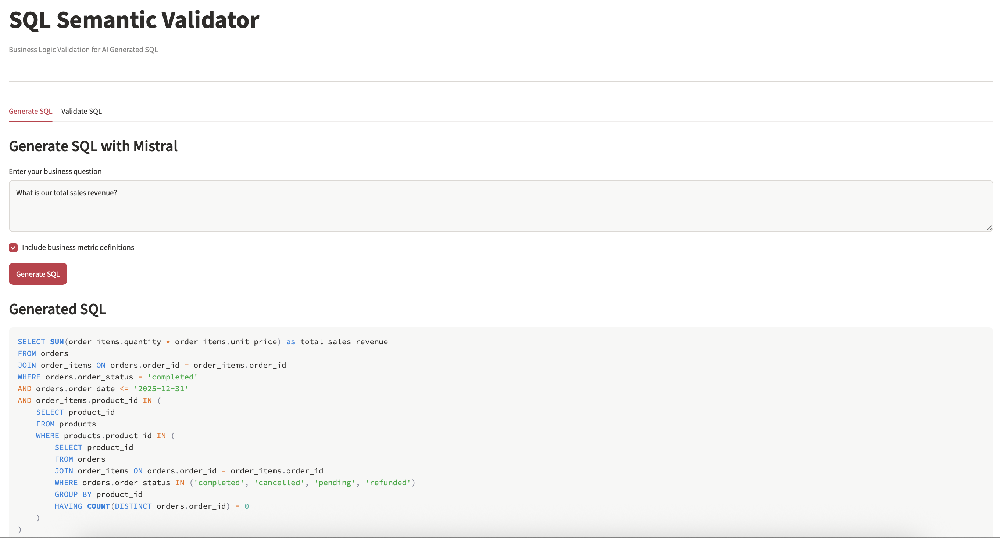

# Text to SQL Semantic Validation

**Evaluating the business accuracy of AI generated SQL using Mistral, DuckDB and SQLGlot.**

## Overview

Large Language Models can generate SQL that executes successfully but produces incorrect business results.

This project investigates whether providing business definitions improves SQL generation and whether semantic validation can detect errors that traditional SQL execution checks miss.

## Tech Stack

Python | Mistral | Ollama | DuckDB | SQLGlot | Pandas | Streamlit

## Approach

Built a reproducible synthetic ecommerce database containing 200 customers, 1,000 orders and 2,557 order items.

Evaluated Mistral under two conditions:

1. **Baseline:** Database schema and business question.
2. **Semantic context:** Schema, question and explicit business metric definitions.

Conducted three experiments with 10 questions per condition, producing 60 SQL generation attempts.

Developed a SQLGlot based validator to identify business logic issues involving order status filters, revenue calculations, date ranges and aggregation grain.

## Results

### Final Evaluation

| Metric | Baseline | Semantic Context |
|---|---:|---:|
| SQL execution success | 70% | 80% |
| Numerical accuracy | 10% | 50% |
| Correct answers | 1/10 | 5/10 |

Semantic context improved numerical accuracy from **10% to 50%** in the final evaluation.

### Validator Regression Testing

After improving the validator using observed failures, all 60 saved SQL generations were tested again.

| Metric | Result |
|---|---:|
| Incorrect queries rejected | 42/42 |
| Incorrect queries approved | 0 |
| Correct answers approved | 17/18 |
| Automated tests passed | 6/6 |

These regression results are based on previously examined queries and do not represent independent validation performance.

## Validation Demo

Built an interactive Streamlit application with two features:

1. **Generate SQL:** Generate queries using Mistral with optional business metric definitions.
2. **Validate SQL:** Detect semantic errors and compare total sales revenue against a verified reference.

The demo shows how SQL can execute successfully but still produce incorrect business results.



## Key Finding

A query can execute successfully and still violate business definitions.

For example, counting orders after joining an order items table can inflate results because one order may contain multiple products.

The project demonstrates the importance of combining **semantic context, SQL validation and reference result evaluation** when building reliable AI analytics systems.

## Run Locally

Install dependencies and download Mistral:

```bash
pip install -r requirements.txt
ollama pull mistral
```

Start Ollama if it is not already running:

```bash
ollama serve
```

Create the database and run the final experiment:

```bash
python setup_database.py
python run_final_test.py
```

Run automated tests:

```bash
python -m unittest test_semantic_validator.py -v
```

## Limitations

The experiments use a small synthetic dataset, one local LLM and limited business questions. The rule based validator cannot detect every possible semantic error.

The findings demonstrate observed behaviour rather than guaranteed performance on unseen queries.

## Future Scope

Extend the evaluation to additional LLMs, larger datasets, more complex SQL patterns and fresh independent test questions.